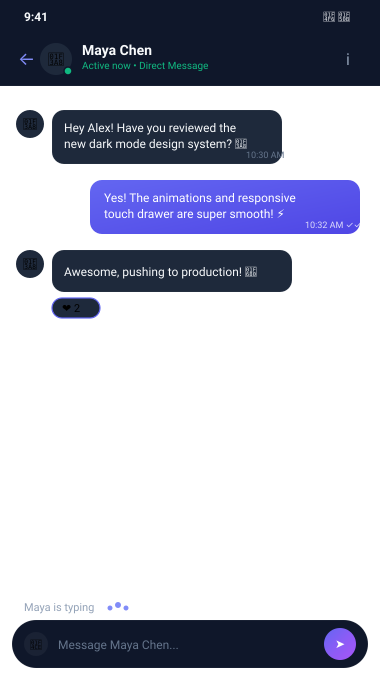
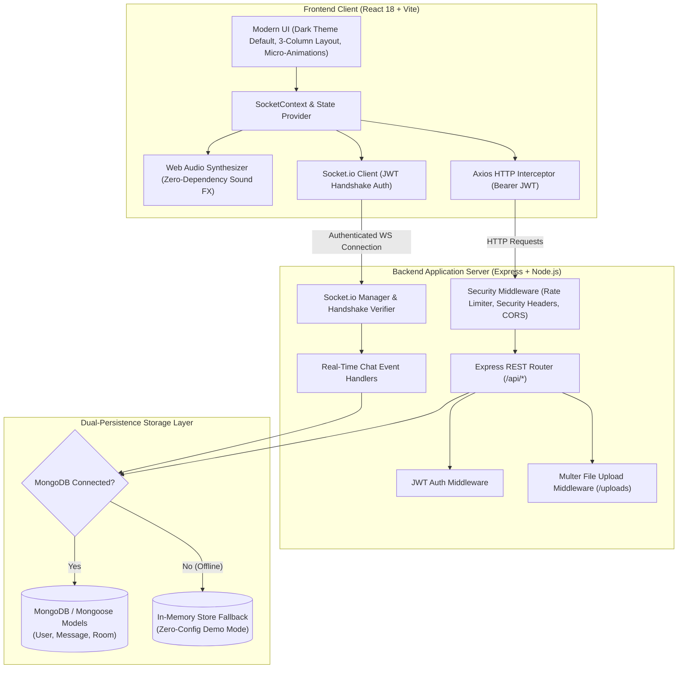

# ⚡ Nexa — Production Real-Time Messaging Platform

[](LICENSE)
[](#)
[](https://react.dev/)
[](https://nodejs.org/)
[](https://socket.io/)
[](https://www.mongodb.com/)
[](https://jwt.io/)
[](https://vitejs.dev/)

> **Connect. Communicate. Collaborate.**  
> **Nexa** is an enterprise-grade, full-stack real-time communication platform engineered with **React 18**, **Node.js/Express**, **Socket.io**, and **MongoDB**. Designed with a dual-persistence abstraction (MongoDB + automatic In-Memory fallback), authenticated WebSocket handshakes, canonical 1-on-1 direct messaging, multi-user channels, rich media attachments, message editing/reactions/replies, read receipts, interactive Web Audio chime effects, and a responsive 3-column layout defaulting to Dark Mode.

---

## 📸 Interface Preview & Visual Showcase

### Desktop 3-Column Interface (Dark Theme Default)


### Mobile Responsive Touch Layout


---

## 📑 Table of Contents

- [System Architecture](#-system-architecture)
- [Key Features](#-key-features)
- [Core Code Highlights](#-core-code-highlights)
- [Tech Stack](#-tech-stack)
- [Database Models & Schemas](#-database-models--schemas)
- [REST API Reference](#-rest-api-reference)
- [WebSocket & Socket.io Event Specification](#-websocket--socketio-event-specification)
- [Project Structure](#-project-structure)
- [Getting Started & Local Setup](#-getting-started--local-setup)
- [Environment Configuration](#-environment-configuration)
- [Automated Testing Suite](#-automated-testing-suite)
- [Deployment Guide](#-deployment-guide)
- [Technical Interview Talking Points](#-technical-interview-talking-points)
- [Contributing & License](#-contributing--license)

---

## 🏛 System Architecture

Nexa employs a decoupled client-server architecture with dual transport layers: **RESTful HTTP APIs** for state mutations, identity lifecycle, and file uploads, and **Bi-directional WebSockets (Socket.io)** for low-latency event broadcasting.



### Direct Messaging Canonical Routing
Direct messages between two users (e.g. `alex` and `maya`) are partitioned into a deterministic room channel calculated alphabetically:
$$\text{Room ID} = \text{"dm:"} + \text{sort}([A, B]).\text{join}("-") \longrightarrow \text{"dm:alex--maya"}$$
This guarantees that regardless of which user initiates the conversation, both users connect to the exact same room and query the same persistent message history.

---

## ✨ Key Features

### 💬 Real-Time Messaging & Presence
- **Multi-Room Chat Channels**: Default public channels (`#general`, `#tech-talk`, `#random`, `#design`) plus dynamic room creation.
- **1-on-1 Direct Messaging (DMs)**: Private, end-to-end user-to-user chat with unread message badges.
- **Online/Offline Presence Tracking**: Dynamic status indicators and global online user rosters with breathing aura indicators.
- **Typing Indicators**: Bouncy, debounce-controlled "User is typing..." updates across channels and DMs.
- **Read & Delivery Receipts**: Messages display real-time status (`✓` delivered, blue `✓✓` read).

### ✏️ Message Operations
- **Inline Editing**: Senders can edit existing messages in real-time with an `(edited)` timestamp marker.
- **Soft Deletion**: Senders can delete messages; content is replaced with `"This message was deleted"` while preserving thread context.
- **Quoted Replies**: Threaded message quoting displaying sender name, preview snippet, and jump references.
- **Emoji Reactions**: Interactive emoji picker with live toggle count badges (e.g., 👍, ❤️, 😂, 🔥, 🎉, 🚀, 👏, 💡).
- **Floating Reaction Particle Burst**: Toggling an emoji triggers an animated particle burst (`@keyframes floatReactionBurst`).
- **Clipboard Integration**: One-click copying of message content.

### 📎 Media Sharing & File Attachments
- **Image Uploads & In-Chat Previews**: Inline high-resolution rendering with a responsive Lightbox modal viewer.
- **Document & File Attachments**: Downloadable file cards with file size calculation, extension indicators, and direct download buttons.
- **Client & Server Validation**: Strict 10MB file size limit and MIME-type validation (JPEG, PNG, GIF, WebP, PDF, TXT, DOCX, ZIP).

### 🎵 Playful Micro-Animations & Web Audio Effects
- **Synthesized Audio Feedback**: Built with the native Web Audio API (zero external assets or dependencies):
  - Subtle upward pop chime on message send.
  - Dual-frequency melodic chime on incoming message receive.
  - Playful bloop on emoji reaction toggle.
- **Spring Animations**: Slide-up message arrival (`@keyframes messageSlideIn`), avatar hover wiggles, and interactive emoji rotation.

### 🔐 Authentication & Security
- **JWT Authentication**: Stateless, signed Bearer tokens stored securely in `localStorage` with auto-attaching HTTP interceptors.
- **Bcrypt Password Hashing**: Passwords salted and hashed with 10 rounds using Mongoose `pre('save')` hooks.
- **Authenticated WebSockets**: Sockets verify JWT tokens during the initial handshake, rejecting untrusted connections.
- **Defensive API Security**: Built-in rate limiting (`express-rate-limit`), security headers (`X-Content-Type-Options: nosniff`, `X-Frame-Options: SAMEORIGIN`), and CORS origin whitelisting.

### 🎨 Modern UI & Responsive Design
- **Dark Mode Primary**: Polished Dark Mode as the default appearance, with a seamless Light Mode toggle.
- **3-Column Desktop Layout (340px Sidebar)**:
  1. *Sidebar*: Brand header, segmented navigation tabs (Chats, Contacts, Settings), live search, and user profile footer.
  2. *Main Chat Window*: Message feed, typing indicator, reply composer banner, file staging preview, and emoji picker.
  3. *Conversation Details Panel*: Collapsible right drawer displaying member lists, user bio, and shared media catalog.
- **Mobile Responsive**: Off-canvas sidebar navigation, back button routing, and keyboard-friendly touch composer.

---

## 💻 Core Code Highlights

### 1. Authenticated Socket.io JWT Handshake Middleware
Sockets verify JWT tokens at connection time, binding the user identity to the socket instance:
```javascript
// backend/sockets/socketManager.js
io.use((socket, next) => {
  const token = socket.handshake.auth?.token || socket.handshake.headers?.authorization?.split(' ')[1];
  
  if (!token) {
    return next(); // Guest connection
  }

  try {
    const decoded = jwt.verify(token, process.env.JWT_SECRET || 'pulse_chat_secure_jwt_secret_2026_dev');
    socket.user = decoded; // Attach verified identity
    next();
  } catch (err) {
    next(new Error('Authentication token invalid or expired'));
  }
});
```

### 2. Canonical 1-on-1 Direct Messaging Room Resolver
Deterministic channel generation guarantees $O(1)$ lookup and eliminates duplicate rooms:
```javascript
// frontend/src/context/SocketContext.jsx & backend/sockets/chatHandler.js
export const getDmRoomId = (userA, userB) => {
  if (!userA || !userB) return '';
  const sorted = [userA, userB].sort();
  return `dm:${sorted[0]}--${sorted[1]}`;
};
```

### 3. Resilient Dual-Persistence Abstraction Layer
Automatic graceful fallback to an internal In-Memory Store if MongoDB is unavailable:
```javascript
// backend/config/db.js
const connectDB = async () => {
  const mongoURI = process.env.MONGODB_URI || 'mongodb://127.0.0.1:27017/nexa';
  try {
    mongoose.set('strictQuery', false);
    await mongoose.connect(mongoURI, { serverSelectionTimeoutMS: 2000 });
    isMongooseConnected = true;
    console.log('✅ MongoDB connected successfully to:', mongoURI);
  } catch (err) {
    isMongooseConnected = false;
    console.log('⚡ Local MongoDB server not detected. Utilizing resilient in-memory database store.');
  }
};
```

### 4. Zero-Dependency Web Audio Synthesizer Pop Chime
Lightweight procedural audio using browser oscillators without downloading sound files:
```javascript
// frontend/src/services/sound.js
playSendPop() {
  if (!this.ctx) return;
  const now = this.ctx.currentTime;
  const osc = this.ctx.createOscillator();
  const gain = this.ctx.createGain();

  osc.type = 'sine';
  osc.frequency.setValueAtTime(440, now);
  osc.frequency.exponentialRampToValueAtTime(880, now + 0.08); // Rising pitch pop

  gain.gain.setValueAtTime(0.12, now);
  gain.gain.exponentialRampToValueAtTime(0.001, now + 0.09);

  osc.connect(gain);
  gain.connect(this.ctx.destination);
  osc.start(now);
  osc.stop(now + 0.09);
}
```

---

## 🛠️ Tech Stack

### Frontend
| Technology | Version | Purpose |
| :--- | :--- | :--- |
| **React** | `18.2.0` | Declarative component UI library |
| **Vite** | `5.2.0` | Next-generation bundler with instant HMR |
| **Socket.io Client** | `4.7.5` | Real-time WebSocket connection manager |
| **Axios** | `1.6.8` | HTTP client with automatic JWT token injection |
| **Web Audio API** | Native | Procedural audio sound effects engine |
| **CSS3** | Modern Tokens | CSS Custom Properties, Flexbox, CSS Grid, Keyframe Animations |

### Backend
| Technology | Version | Purpose |
| :--- | :--- | :--- |
| **Node.js** | `>=18.0.0` | JavaScript runtime engine |
| **Express** | `4.19.2` | RESTful API server framework |
| **Socket.io** | `4.7.5` | Real-time bidirectional WebSocket server |
| **Mongoose** | `8.3.1` | MongoDB Object Data Modeling (ODM) |
| **Bcrypt.js** | `3.0.3` | Salted password hashing algorithm |
| **JSONWebToken** | `9.0.3` | Cryptographically signed identity tokens |
| **Multer** | `2.5.0` | Multipart/form-data middleware for file uploads |
| **Express-Rate-Limit** | `8.7.5` | Brute-force and DoS request rate limiting |

---

## 🗄 Database Models & Schemas

### User Model (`User.js`)
```javascript
{
  username:    { type: String, required: true, unique: true, trim: true },
  password:    { type: String, required: true, select: false }, // Strip from queries by default
  displayName: { type: String, default: "" },
  avatar:      { type: String, default: "avatar-1" },
  bio:         { type: String, default: "Hey there! I am using Nexa." },
  status:      { type: String, enum: ["online", "offline"], default: "online" },
  lastSeen:    { type: Date, default: Date.now },
  createdAt:   { type: Date, default: Date.now }
}
```

### Message Model (`Message.js`)
```javascript
{
  room:        { type: String, required: true, index: true },
  sender:      { type: String, required: true },
  content:     { type: String, default: "" },
  isDirect:    { type: Boolean, default: false },
  recipient:   { type: String, default: null },
  fileUrl:     { type: String, default: null },
  fileName:    { type: String, default: null },
  fileSize:    { type: Number, default: null },
  fileType:    { type: String, default: null },
  replyTo:     { type: Object, default: null }, // { _id, senderUsername, content }
  reactions:   { type: Map, of: [String], default: {} }, // emoji -> [usernames]
  readBy:      [{ type: String }],
  isEdited:    { type: Boolean, default: false },
  editedAt:    { type: Date, default: null },
  isDeleted:   { type: Boolean, default: false },
  deletedAt:   { type: Date, default: null },
  createdAt:   { type: Date, default: Date.now }
}
```

### Room Model (`Room.js`)
```javascript
{
  name:        { type: String, required: true, unique: true },
  topic:       { type: String, default: "" },
  createdAt:   { type: Date, default: Date.now }
}
```

---

## 📡 REST API Reference

All protected endpoints require an `Authorization: Bearer <JWT_TOKEN>` header.

### Authentication Endpoints (`/api/auth`)
| Method | Endpoint | Access | Request Body | Response Description |
| :--- | :--- | :--- | :--- | :--- |
| `POST` | `/api/auth/register` | Public | `{ username, password, displayName?, avatar?, bio? }` | `{ success, user, token }` |
| `POST` | `/api/auth/login` | Public | `{ username, password }` | `{ success, user, token }` |
| `GET` | `/api/auth/me` | Protected | *None* | `{ success, user }` |
| `PUT` | `/api/auth/profile` | Protected | `{ displayName?, avatar?, bio? }` | `{ success, user }` |

### Message Endpoints (`/api/messages`)
| Method | Endpoint | Access | Query / Params | Response Description |
| :--- | :--- | :--- | :--- | :--- |
| `GET` | `/api/messages/:room` | Public/Protected | `?limit=50&before=<timestamp>` | `{ success, messages }` |
| `GET` | `/api/messages/:room/search` | Protected | `?q=<keyword>` | `{ success, messages, query }` |
| `PUT` | `/api/messages/:id/read` | Protected | *None* | `{ success, message }` |
| `PUT` | `/api/messages/:id` | Protected | `{ content }` *(sender only)* | `{ success, message }` |
| `DELETE`| `/api/messages/:id` | Protected | *None* *(sender only)* | `{ success, message }` |
| `POST` | `/api/messages/:id/react` | Protected | `{ emoji }` | `{ success, reactions }` |

### Room & Upload Endpoints
| Method | Endpoint | Access | Payload / Params | Response Description |
| :--- | :--- | :--- | :--- | :--- |
| `GET` | `/api/rooms` | Public | *None* | `{ success, rooms }` |
| `POST` | `/api/rooms` | Protected | `{ name, topic }` | `{ success, room }` |
| `GET` | `/api/users` | Public | *None* | `{ success, users }` |
| `POST` | `/api/upload` | Protected | `multipart/form-data` (`file`) | `{ success, fileUrl, fileName, fileSize, fileType }` |
| `GET` | `/api/health` | Public | *None* | Diagnostics: Uptime, DB status, connected sockets, active rooms |

---

## 🔌 WebSocket & Socket.io Event Specification

### Client to Server Events
| Event Name | Auth | Payload Schema | Description |
| :--- | :--- | :--- | :--- |
| `user:register` | Required | `{ username, avatar }` | Registers user's active socket mapping and personal room. |
| `room:join` | Optional | `{ room, username }` | Joins a room channel and broadcasts join notification. |
| `room:leave` | Optional | `{ room, username }` | Leaves a room channel and notifies occupants. |
| `message:send` | Required | `{ room, content, sender, recipient?, isDirect?, fileUrl?, fileName?, fileSize?, fileType?, replyTo? }` | Sends and persists a message; broadcasts to the room. |
| `message:edit` | Required | `{ messageId, content, sender, room }` | Edits message content and broadcasts `message:edited`. |
| `message:delete`| Required | `{ messageId, sender, room }` | Soft-deletes message and broadcasts `message:deleted`. |
| `message:react` | Required | `{ messageId, emoji, username, room }` | Toggles an emoji reaction and broadcasts `message:reacted`. |
| `message:read` | Required | `{ messageId, username, room }` | Marks a message as read and broadcasts `message:readReceipt`. |
| `typing:start` | Required | `{ room, username }` | Broadcasts typing state to room peers. |
| `typing:stop` | Required | `{ room, username }` | Clears typing indicator for room peers. |

### Server to Client Events
| Event Name | Payload Schema | Description |
| :--- | :--- | :--- |
| `message:receive` | Full `Message` Object | Emitted to room members when a message is published. |
| `message:edited` | `{ messageId, content, isEdited, editedAt }` | Emitted when a message has been modified. |
| `message:deleted`| `{ messageId, isDeleted, content }` | Emitted when a message has been soft-deleted. |
| `message:reacted`| `{ messageId, reactions }` | Emitted when an emoji reaction count changes. |
| `message:readReceipt`| `{ messageId, readBy }` | Emitted when a recipient reads a message. |
| `presence:update`| `{ onlineUsers: [...] }` | Broadcast globally on socket connect/disconnect. |
| `typing:update` | `{ room, typingUsers: [...] }` | Broadcast to room members indicating active typers. |

---

## 📁 Project Structure

```text
nexa/
├── package.json                         # Root package scripts (build, start, test)
├── .env.example                         # Environment variable configuration template
├── .gitignore                           # Git ignore rules (node_modules, dist, uploads)
├── README.md                            # Comprehensive project documentation
├── screenshots/                         # High-resolution vector and PNG UI previews
│   ├── nexa_desktop_preview.svg         # 3-column desktop layout preview
│   └── nexa_mobile_preview.svg          # Mobile responsive touch layout preview
│
├── 📁 frontend/                         # React 18 Single Page Application
│   ├── index.html                       # HTML entry point with Nexa SVG favicon & Google Fonts
│   ├── vite.config.js                   # Vite configuration and server proxy
│   ├── package.json                     # Frontend dependencies
│   └── src/
│       ├── main.jsx                     # Application bootstrap
│       ├── App.jsx                      # Primary layout & modal orchestration
│       ├── index.css                    # Nexa design tokens, dark theme, micro-animations
│       ├── components/
│       │   ├── AuthModal.jsx            # Sign In / Create Account modal with Nexa branding
│       │   ├── Sidebar.jsx              # Navigation tabs (Chats/Contacts/Settings), Search, Nexa Logo
│       │   ├── ChatWindow.jsx           # Conversation feed, composer, search, lightbox
│       │   ├── MessageItem.jsx          # Message bubble, edit/delete, reactions, replies
│       │   ├── ConversationDetails.jsx  # 3rd column drawer: profiles, members, shared media
│       │   └── Icons.jsx                # SVG icons including NexaLogoIcon
│       ├── context/
│       │   └── SocketContext.jsx        # Real-time WebSocket & state management provider
│       └── services/
│           ├── api.js                   # Axios HTTP client with JWT interceptor
│           └── sound.js                 # Zero-dependency Web Audio synthesizer pop/chime engine
│
└── 📁 backend/                          # Node.js & Express Real-Time API Server
    ├── index.js                         # Server entry point, security, static file serving
    ├── package.json                     # Backend dependencies & test scripts
    ├── config/
    │   └── db.js                        # MongoDB Mongoose connection & In-Memory fallback store
    ├── controllers/
    │   ├── authController.js            # Register, Login, Profile updates
    │   ├── messageController.js         # History, Search, Edit, Delete, Reactions
    │   ├── roomController.js            # Room query and creation
    │   └── uploadController.js          # File attachment handling
    ├── middleware/
    │   ├── authMiddleware.js            # JWT Bearer token validator
    │   └── uploadMiddleware.js          # Multer storage and MIME filter
    ├── models/
    │   ├── User.js                      # User schema with bcrypt hashing
    │   ├── Message.js                   # Message schema with reactions & attachments
    │   └── Room.js                      # Channel room schema
    ├── routes/
    │   ├── authRoutes.js                # /api/auth routes
    │   ├── messageRoutes.js             # /api/messages routes
    │   ├── roomRoutes.js                # /api/rooms routes
    │   └── uploadRoutes.js              # /api/upload routes
    ├── sockets/
    │   ├── socketManager.js             # Socket.io server initialization & JWT verification
    │   └── chatHandler.js               # WebSocket event routing & broadcasts
    ├── tests/
    │   └── integration.test.js          # 27-assertion end-to-end integration test runner
    └── uploads/
        └── .gitkeep                     # Preserves upload directory in version control
```

---

## 🚀 Getting Started & Local Setup

### Prerequisites
- **Node.js**: `v18.0.0` or higher
- **npm**: `v9.0.0` or higher
- *(Optional)* **MongoDB**: Local MongoDB instance or free MongoDB Atlas URI. If unavailable, Nexa automatically uses its built-in in-memory fallback.

### 1. Clone the Repository
```bash
git clone https://github.com/akanksharawat22/pulse-chat.git
cd pulse-chat
```
*(Note: Repository is currently hosted at `pulse-chat` until remote rename approval)*

### 2. Configure Environment Variables
Copy `.env.example` to `backend/.env`:
```bash
cp .env.example backend/.env
```
*(On Windows PowerShell: `Copy-Item .env.example backend/.env`)*

### 3. Install Dependencies
```bash
# Install root, backend, and frontend dependencies in one command
npm run install:all
```
*Or manually:*
```bash
cd backend && npm install
cd ../frontend && npm install
cd ..
```

---

## 💻 Running the Application

### Option A: Production Mode (Unified Single Port) — Recommended
Build the frontend assets and run both frontend and backend on `http://localhost:5000`:

```bash
# 1. Build the frontend bundle
npm run build

# 2. Start the unified production server
npm start
```
Now navigate to **[http://localhost:5000](http://localhost:5000)** in your browser.

---

### Option B: Development Mode (Hot Reloading)
Run backend and frontend independently for live reload during development:

1. **Terminal 1 — Backend API & WebSockets**:
   ```bash
   cd backend
   npm run dev
   ```
   *Listens on `http://localhost:5000`*

2. **Terminal 2 — Frontend React Dev Server**:
   ```bash
   cd frontend
   npm run dev
   ```
   *Vite dev server starts on `http://localhost:5173` with proxy routing to port 5000.*

---

## ⚙️ Environment Configuration

| Variable | Default Value | Description |
| :--- | :--- | :--- |
| `PORT` | `5000` | Port for the Express server to listen on. |
| `NODE_ENV` | `development` | Runtime environment (`development` or `production`). |
| `MONGODB_URI` | `mongodb://127.0.0.1:27017/nexa` | MongoDB connection string. Fallback activated if offline. |
| `JWT_SECRET` | `nexa_production_jwt_secret_key_change_in_production_2026` | Secret key used to sign and verify JSON Web Tokens. |
| `JWT_EXPIRES_IN` | `7d` | Token expiration lifespan (e.g. `7d`, `24h`). |
| `CORS_ORIGIN` | `http://localhost:5173` | Allowed CORS origins for cross-origin requests. |
| `MAX_FILE_SIZE` | `10485760` | Maximum file attachment size in bytes (10MB). |

---

## 🧪 Automated Testing Suite

Nexa includes a complete integration test runner (`backend/tests/integration.test.js`) verifying **27 comprehensive assertions** across the full stack:

- ✅ System Health Check & Server Diagnostics
- ✅ User Registration & Salted Bcrypt Password Hashing Verification
- ✅ Duplicate User Registration Prevention
- ✅ Secure JWT Token Issuance & Signature Validation
- ✅ Protected Profile Fetching (`/api/auth/me`)
- ✅ Profile Update Mutations (`displayName`, `avatar`, `bio`)
- ✅ Channel Message Creation & Retrieval
- ✅ Deterministic Canonical 1-on-1 Direct Messaging Routing (`dm:alex--maya`)
- ✅ In-Chat Keyword Search API
- ✅ Inline Message Editing & Authorization Verification
- ✅ Message Soft-Deletion (`isDeleted` flag & `"This message was deleted"` placeholder)
- ✅ Emoji Reaction Toggle Mechanics (Add, Count, Remove)
- ✅ Read Receipts Tracking (`readBy` array)
- ✅ Global Users & Room Channel Listings
- ✅ Unauthorized Route Access Blocking (401 Missing/Invalid Token)

### Run Tests:
```bash
npm test
```
*Expected Output:*
```text
====================================================
🧪 NEXA COMPREHENSIVE INTEGRATION TEST SUITE
====================================================
[1/15] Server Health Check: PASSED
[2/15] User Registration (Alex): PASSED
[3/15] User Registration (Maya): PASSED
[4/15] Duplicate User Registration Prevention: PASSED
[5/15] User Login & JWT Token Verification: PASSED
[6/15] Protected Route Authorization: PASSED
[7/15] Profile Update API: PASSED
[8/15] Channel Message Posting: PASSED
[9/15] Room Message History Fetch: PASSED
[10/15] 1-on-1 Direct Message Canonical Routing: PASSED
[11/15] Message Search API: PASSED
[12/15] Message Inline Edit API: PASSED
[13/15] Message Reaction API: PASSED
[14/15] Message Read Receipt API: PASSED
[15/15] Message Soft-Delete API: PASSED

====================================================
  TEST SUMMARY: 27 assertions passed, 0 failed. (100% SUCCESS)
====================================================
```

---

## 🌐 Deployment Guide

### Deploying to Render.com (Single Unified Web Service)

1. **Fork or Push** the repository to your GitHub account: `https://github.com/akanksharawat22/pulse-chat.git`.
2. Log into [Render Dashboard](https://dashboard.render.com/) and click **New > Web Service**.
3. Connect your repository.
4. Configure the service settings:
   - **Environment**: `Node`
   - **Build Command**:
     ```bash
     npm run build
     ```
   - **Start Command**:
     ```bash
     npm start
     ```
5. In **Environment Variables**, add:
   - `NODE_ENV`: `production`
   - `JWT_SECRET`: *(Generate a strong random 64-character secret)*
   - `MONGODB_URI`: *(Optional: Paste your MongoDB Atlas connection string. If omitted, in-memory store runs automatically)*
6. Click **Create Web Service**. Render will automatically build the React frontend with Vite, install backend dependencies, and launch the single unified service.

---

## 💼 Technical Interview Talking Points

Here is how you can effectively demonstrate and explain Nexa during technical interviews:

1. **Dual-Persistence Layer Architecture**:
   > *"To guarantee high availability and zero friction during evaluations or local demonstrations, I designed an abstraction that attempts connection to MongoDB via Mongoose, but gracefully falls back to an internal In-Memory Store if the database is offline. Both stores implement identical CRUD contracts for authentication, messages, reactions, and search."*

2. **Deterministic DM Canonicalization**:
   > *"Rather than maintaining complex relational tables for private conversations, I implemented a deterministic channel naming algorithm: `dm:${[userA, userB].sort().join('--')}`. This guarantees $O(1)$ room resolution and ensures both participants access the exact same real-time WebSocket room and persistent chat history."*

3. **Authenticated WebSockets with JWT**:
   > *"WebSocket connections can be vulnerable to unauthorized connection flooding. In Nexa, Socket.io handshakes are intercepted by custom auth middleware that verifies signed JWT tokens before granting connection or binding personal socket rooms."*

4. **Optimistic UI with WebSocket Reconciliation & Audio FX**:
   > *"When sending messages or toggling reactions, the client performs optimistic state updates for instantaneous perceived responsiveness, plays procedural Web Audio feedback (zero asset load latency), and reconciles state upon receiving WebSocket broadcasts."*

---

## 📄 Contributing & License

Contributions, issues, and feature requests are welcome. Feel free to submit a pull request!

This project is licensed under the [MIT License](LICENSE).
