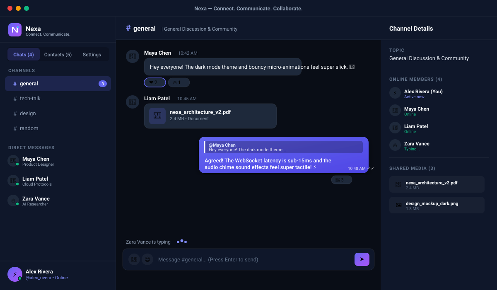
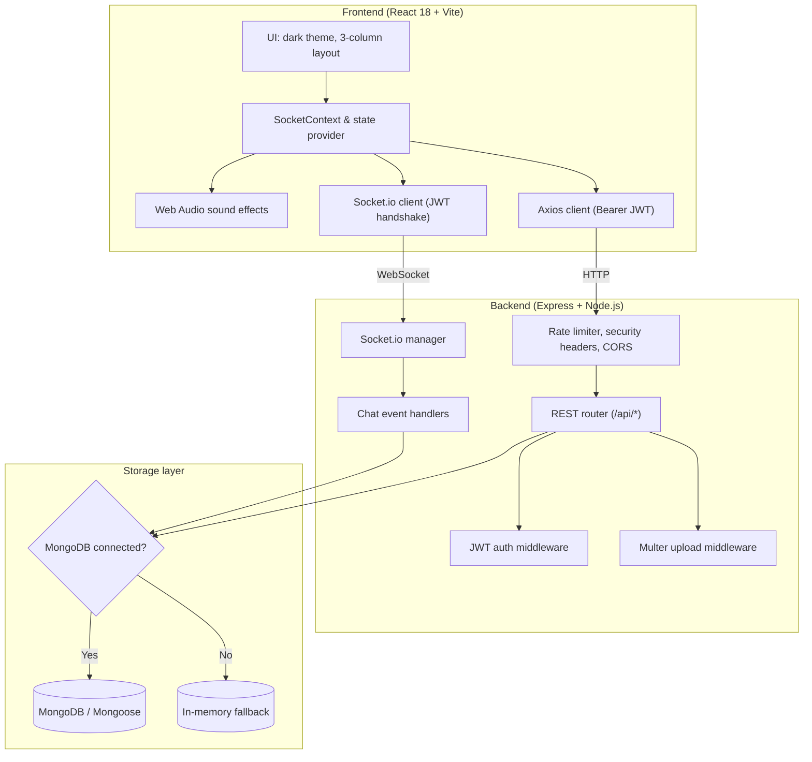

# ⚡ Nexa — Real-Time Messaging Platform


> **Connect. Communicate. Collaborate.**
> Nexa is a full-stack real-time chat app built with **React 18**, **Node.js/Express**, **Socket.io** and **MongoDB**. It supports public channels, 1-on-1 direct messages, file sharing, message editing, reactions, replies and read receipts, with a responsive 3-column layout that defaults to dark mode.

---

## 📸 Preview

### Desktop (3-column, dark theme)


### Mobile


---

## 📑 Table of Contents

- [Architecture](#-architecture)
- [Features](#-features)
- [Tech Stack](#-tech-stack)
- [Data Models](#-data-models)
- [REST API](#-rest-api)
- [Socket.io Events](#-socketio-events)
- [Project Structure](#-project-structure)
- [Getting Started](#-getting-started)
- [Environment Variables](#-environment-variables)
- [Testing](#-testing)
- [Deployment](#-deployment)
- [Known Limitations](#-known-limitations)
- [Contributing & License](#-contributing--license)

---

## 🏛 Architecture

Nexa uses a decoupled client–server design with two transports: **REST** for auth, message mutations and file uploads, and **Socket.io** for low-latency real-time events.



### Direct message routing

Each DM uses a deterministic room ID built from the two usernames, sorted alphabetically:

```js
const getDmRoomId = (a, b) => `dm:${[a, b].sort().join('--')}`;
// getDmRoomId('maya', 'alex') -> 'dm:alex--maya'
```

Whichever user starts the conversation, both end up in the same room with the same message history.

### Storage fallback

If MongoDB can't be reached at startup (2 second timeout), Nexa switches to an in-memory store so the app still runs with zero setup. Data in this mode is lost on restart, so it's intended for demos and local development only.

---

## ✨ Features

**Messaging & presence**
- Public channels (`#general`, `#tech-talk`, `#random`, `#design`) plus user-created rooms
- 1-on-1 direct messages with unread badges
- Online/offline presence and a live user roster
- Debounced typing indicators
- Delivery and read receipts (✓ / blue ✓✓)

**Message operations**
- Inline editing with an `(edited)` marker
- Soft deletion (shows "This message was deleted", keeps thread context)
- Quoted replies
- Emoji reactions with live counts and a particle-burst animation
- One-click copy

**Attachments**
- Image uploads with inline preview and lightbox
- File cards with size and extension (JPEG, PNG, GIF, WebP, PDF, TXT, DOCX, ZIP)
- 10 MB limit, validated on both client and server

**Sound & animation**
- Send, receive and reaction sounds synthesized with the native Web Audio API (no audio files)
- Slide-in messages, avatar hover effects, emoji animations

**Auth & security**
- JWT authentication with an Axios interceptor
- Bcrypt password hashing (10 rounds, Mongoose `pre('save')` hook)
- JWT verification during the Socket.io handshake
- Rate limiting (`express-rate-limit`), security headers and CORS configuration

**UI**
- Dark mode by default with a light mode toggle
- Desktop: sidebar (chats, contacts, settings, search), chat window, collapsible details panel (members, bio, shared media)
- Mobile: off-canvas sidebar and touch-friendly composer

---

## 🛠 Tech Stack

### Frontend

| Technology | Version | Purpose |
| --- | --- | --- |
| React | 18.2.0 | UI library |
| Vite | 5.2.0 | Bundler and dev server |
| Socket.io Client | 4.7.5 | Real-time connection |
| Axios | 1.6.8 | HTTP client with JWT injection |
| Web Audio API | Native | Sound effects |
| CSS3 | — | Custom properties, Grid/Flexbox, keyframe animations |

### Backend

| Technology | Version | Purpose |
| --- | --- | --- |
| Node.js | >= 18.0.0 | Runtime |
| Express | 4.19.2 | REST API |
| Socket.io | 4.7.5 | WebSocket server |
| Mongoose | 8.3.1 | MongoDB ODM |
| Bcrypt.js | 3.0.3 | Password hashing |
| JSONWebToken | 9.0.3 | Signed tokens |
| Multer | 2.5.0 | File uploads |
| Express-Rate-Limit | 8.7.5 | Request rate limiting |

> Versions reflect `package.json` at the time of writing; check the package files for the current values.

---

## 🗄 Data Models

### User
```js
{
  username:    { type: String, required: true, unique: true, trim: true },
  password:    { type: String, required: true, select: false },
  displayName: { type: String, default: "" },
  avatar:      { type: String, default: "avatar-1" },
  bio:         { type: String, default: "Hey there! I am using Nexa." },
  status:      { type: String, enum: ["online", "offline"], default: "online" },
  lastSeen:    { type: Date, default: Date.now },
  createdAt:   { type: Date, default: Date.now }
}
```

### Message
```js
{
  room:      { type: String, required: true, index: true },
  sender:    { type: String, required: true },
  content:   { type: String, default: "" },
  isDirect:  { type: Boolean, default: false },
  recipient: { type: String, default: null },
  fileUrl:   { type: String, default: null },
  fileName:  { type: String, default: null },
  fileSize:  { type: Number, default: null },
  fileType:  { type: String, default: null },
  replyTo:   { type: Object, default: null },        // { _id, senderUsername, content }
  reactions: { type: Map, of: [String], default: {} }, // emoji -> [usernames]
  readBy:    [{ type: String }],
  isEdited:  { type: Boolean, default: false },
  editedAt:  { type: Date, default: null },
  isDeleted: { type: Boolean, default: false },
  deletedAt: { type: Date, default: null },
  createdAt: { type: Date, default: Date.now }
}
```

### Room
```js
{
  name:      { type: String, required: true, unique: true },
  topic:     { type: String, default: "" },
  createdAt: { type: Date, default: Date.now }
}
```

---

## 📡 REST API

Protected endpoints require `Authorization: Bearer <JWT>`.

### Auth (`/api/auth`)

| Method | Endpoint | Access | Body | Response |
| --- | --- | --- | --- | --- |
| POST | `/api/auth/register` | Public | `{ username, password, displayName?, avatar?, bio? }` | `{ success, user, token }` |
| POST | `/api/auth/login` | Public | `{ username, password }` | `{ success, user, token }` |
| GET | `/api/auth/me` | Protected | — | `{ success, user }` |
| PUT | `/api/auth/profile` | Protected | `{ displayName?, avatar?, bio? }` | `{ success, user }` |

### Messages (`/api/messages`)

| Method | Endpoint | Access | Params | Response |
| --- | --- | --- | --- | --- |
| GET | `/api/messages/:room` | Public/Protected | `?limit=50&before=<timestamp>` | `{ success, messages }` |
| GET | `/api/messages/:room/search` | Protected | `?q=<keyword>` | `{ success, messages, query }` |
| PUT | `/api/messages/:id/read` | Protected | — | `{ success, message }` |
| PUT | `/api/messages/:id` | Protected | `{ content }` (sender only) | `{ success, message }` |
| DELETE | `/api/messages/:id` | Protected | — (sender only) | `{ success, message }` |
| POST | `/api/messages/:id/react` | Protected | `{ emoji }` | `{ success, reactions }` |

### Rooms, users, uploads, health

| Method | Endpoint | Access | Payload | Response |
| --- | --- | --- | --- | --- |
| GET | `/api/rooms` | Public | — | `{ success, rooms }` |
| POST | `/api/rooms` | Protected | `{ name, topic }` | `{ success, room }` |
| GET | `/api/users` | Public | — | `{ success, users }` |
| POST | `/api/upload` | Protected | `multipart/form-data` (`file`) | `{ success, fileUrl, fileName, fileSize, fileType }` |
| GET | `/api/health` | Public | — | Uptime, DB status, connected sockets, active rooms |

---

## 🔌 Socket.io Events

Sockets connect with an optional JWT passed in the handshake (`auth.token`). Events marked **Required** need an authenticated user.

### Client → Server

| Event | Auth | Payload | Description |
| --- | --- | --- | --- |
| `user:register` | Required | `{ username, avatar }` | Maps the socket to the user and their personal room |
| `room:join` | Optional | `{ room, username }` | Join a room and announce it |
| `room:leave` | Optional | `{ room, username }` | Leave a room and notify members |
| `message:send` | Required | `{ room, content, sender, recipient?, isDirect?, fileUrl?, fileName?, fileSize?, fileType?, replyTo? }` | Persist and broadcast a message |
| `message:edit` | Required | `{ messageId, content, sender, room }` | Edit a message |
| `message:delete` | Required | `{ messageId, sender, room }` | Soft-delete a message |
| `message:react` | Required | `{ messageId, emoji, username, room }` | Toggle a reaction |
| `message:read` | Required | `{ messageId, username, room }` | Mark a message as read |
| `typing:start` | Required | `{ room, username }` | Start typing indicator |
| `typing:stop` | Required | `{ room, username }` | Clear typing indicator |

### Server → Client

| Event | Payload | Description |
| --- | --- | --- |
| `message:receive` | Full `Message` object | New message in a room |
| `message:edited` | `{ messageId, content, isEdited, editedAt }` | Message edited |
| `message:deleted` | `{ messageId, isDeleted, content }` | Message soft-deleted |
| `message:reacted` | `{ messageId, reactions }` | Reaction counts changed |
| `message:readReceipt` | `{ messageId, readBy }` | Message read by a recipient |
| `presence:update` | `{ onlineUsers: [...] }` | Sent on every connect/disconnect |
| `typing:update` | `{ room, typingUsers: [...] }` | Current typers in a room |

---

## 📁 Project Structure

```
Nexa/
├── package.json                 # Root scripts (install:all, build, start, test)
├── .env.example                 # Environment variable template
├── .gitignore
├── README.md
├── screenshots/                 # UI previews
│   ├── nexa_desktop_preview.svg
│   └── nexa_mobile_preview.svg
│
├── frontend/                    # React 18 SPA
│   ├── index.html
│   ├── vite.config.js           # Vite config and dev proxy
│   ├── package.json
│   └── src/
│       ├── main.jsx
│       ├── App.jsx
│       ├── index.css            # Design tokens, dark theme, animations
│       ├── components/
│       │   ├── AuthModal.jsx
│       │   ├── Sidebar.jsx
│       │   ├── ChatWindow.jsx
│       │   ├── MessageItem.jsx
│       │   ├── ConversationDetails.jsx
│       │   ├── TypingIndicator.jsx
│       │   └── Icons.jsx
│       ├── context/
│       │   └── SocketContext.jsx
│       └── services/
│           ├── api.js           # Axios client with JWT interceptor
│           └── sound.js         # Web Audio sound engine
│
└── backend/                     # Express + Socket.io server
    ├── index.js                 # Entry point, security, static serving
    ├── package.json
    ├── config/db.js             # MongoDB connection + in-memory fallback
    ├── controllers/             # auth, message, room, upload
    ├── middleware/              # authMiddleware, uploadMiddleware
    ├── models/                  # User, Message, Room
    ├── routes/                  # auth, message, room, upload
    ├── sockets/                 # socketManager, chatHandler
    ├── tests/integration.test.js
    └── uploads/.gitkeep
```

---

## 🚀 Getting Started

### Prerequisites
- Node.js 18+ and npm 9+
- MongoDB (optional): a local instance or a MongoDB Atlas URI. Without it, Nexa uses the in-memory fallback.

### 1. Clone

```bash
git clone https://github.com/akanksharawat22/Nexa.git
cd Nexa
```

### 2. Configure environment

```bash
cp .env.example backend/.env
```

On Windows PowerShell: `Copy-Item .env.example backend/.env`

Open `backend/.env` and set a strong, unique `JWT_SECRET` (see [Environment Variables](#-environment-variables)).

### 3. Install dependencies

```bash
npm run install:all
```

Or manually:

```bash
cd backend && npm install
cd ../frontend && npm install
cd ..
```

### 4. Run

**Option A: single-port production build**

```bash
npm run build
npm start
```

Open http://localhost:5000.

**Option B: development with hot reload**

```bash
# Terminal 1: backend (http://localhost:5000)
cd backend
npm run dev

# Terminal 2: frontend (http://localhost:5173, proxies to :5000)
cd frontend
npm run dev
```

---

## ⚙️ Environment Variables

| Variable | Default | Description |
| --- | --- | --- |
| `PORT` | `5000` | Server port |
| `NODE_ENV` | `development` | `development` or `production` |
| `MONGODB_URI` | `mongodb://127.0.0.1:27017/nexa` | MongoDB connection string; falls back to in-memory if unreachable |
| `JWT_SECRET` | `nexa_jwt_secret_dev_key_2026` (dev fallback) | Secret used to sign and verify JWTs. Set your own long random value, e.g. `node -e "console.log(require('crypto').randomBytes(48).toString('hex'))"` |
| `JWT_EXPIRES_IN` | `7d` | Token lifetime (`7d`, `24h`, ...) |
| `CORS_ORIGIN` | `http://localhost:5173` | Allowed CORS origin(s) |
| `MAX_FILE_SIZE` | `10485760` | Max upload size in bytes (10 MB) |

Never commit a real `.env` file or reuse the example secret in production.

---

## 🧪 Testing

The integration suite (`backend/tests/integration.test.js`) runs **10 test groups with 27 assertions** against a running server:

- Health check and diagnostics
- User registration (password omitted from the response)
- Login and JWT issuance, with rejection of a wrong password
- Protected route access (`/api/auth/me`) and 401 for unauthenticated requests
- Profile updates
- Channel creation and listing
- File upload
- Message history fetch
- Keyword message search
- Read receipts

The tests call the live API, so start the backend first, then run the tests from another terminal:

```bash
# Terminal 1
cd backend
node index.js

# Terminal 2 (project root)
npm test
```

Restart the server before each run, since the in-memory store keeps the test users between runs.

---

## 🌐 Deployment

Nexa is not currently deployed. The steps below are an optional guide for hosting it yourself.

### Render (single web service)

1. Push the repo to GitHub: `https://github.com/akanksharawat22/Nexa`.
2. In the [Render dashboard](https://dashboard.render.com/), choose **New > Web Service** and connect the repo.
3. Settings:
   - **Environment:** Node
   - **Build command:** `npm run build`
   - **Start command:** `npm start`
4. Environment variables:
   - `NODE_ENV` = `production`
   - `JWT_SECRET` = a strong random value (64+ characters)
   - `MONGODB_URI` = your Atlas connection string (strongly recommended; without it, data is lost on every restart)
   - `CORS_ORIGIN` = your deployed URL
5. Click **Create Web Service**. Render builds the Vite frontend and serves everything from one service.

---

## ⚠️ Known Limitations

- Messages are **not end-to-end encrypted**; they are stored on the server in plain text.
- If `JWT_SECRET` is not set, the server falls back to a built-in development key, so always set your own before running anywhere other than your own machine.
- The JWT is stored in `localStorage`, so it is exposed to any XSS vulnerability.
- The in-memory fallback loses all data on restart.
- Uploaded files are stored on the server's local disk, which is ephemeral on most free hosting tiers.

---

## 📄 Contributing & License

Issues and pull requests are welcome. Licensed under the [MIT License](LICENSE).